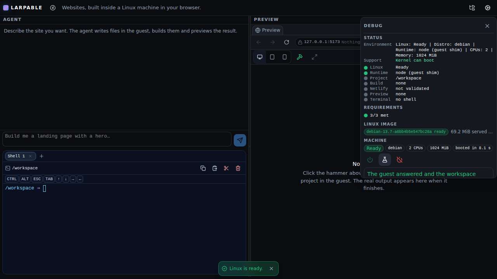

# Browser boot report

Generated by `bun run acceptance:browser`. Every value below was read out of the
rendered page during a real browser session — nothing here is estimated or typed by
hand. Re-run the command to replace this file with fresh measurements.

**Verdict: FAIL** — 14/15 checks passed.

## Failure

```
persistence: /workspace/persist-check.txt holds the bytes the host sent — the guest never answered; host sent 78 bytes; transcript tail:  base64 -d > persist-check.txt [?2004l [?2004h]0;user@unkernel: /workspace/workspace ⇒ printf 'LARPABLE-%s %s %s\n' SIZE persist-check.txt "$(wc -c < persi st-check.txt | tr -d ' ')
```

## Session

| Field | Value |
| --- | --- |
| Started at | 2026-11-23T15:33:06.533Z |
| Browser | Chromium 159.0.8154.6 |
| Chromium binary | `/root/.cache/ms-playwright/chromium-1255/chrome-linux64/chrome` |
| Page | http://127.0.0.1:5173 |
| Target | local dev server |
| Dev server | started by this script |

## Checks

| Check | Result | Detail |
| --- | --- | --- |
| supported browser: the app rendered | PASS | environment panel at http://127.0.0.1:5173 |
| supported browser: support probe passes | PASS | no support problems reported |
| supported browser: boot control offered in the debug popover | PASS | 1 boot button(s) |
| environment reports Ready | PASS | status badge reads "Ready" |
| environment reports its distro | PASS | debian |
| environment reports its CPUs | PASS | 2 CPUs |
| environment reports its memory | PASS | 1024 MiB |
| status bar shows the live environment | PASS | EnvironmentLinux: Ready \| Distro: debian \| Runtime: node (guest shim) \| CPUs: 2 \| Memory: 1024 MiB |
| self-test: guest command ran | PASS | Linux unkernel 7.3.4+ #909a1964cecb SMP Fri Nov 20 16:38:40 UTC 2026 aarch64 GNU/Linux |
| self-test: uname reports aarch64 | PASS | Linux unkernel 7.3.4+ #909a1964cecb SMP Fri Nov 20 16:38:40 UTC 2026 aarch64 GNU/Linux |
| self-test: host -> guest round-trip | PASS | /workspace/.larpable/host-to-guest.txt arrived intact |
| self-test: guest -> host round-trip | PASS | /workspace/.larpable/guest-to-host.txt arrived intact |
| self-test: overall verdict | PASS | The guest answered and the workspace round-trips. 613 ms |
| persistence: project created through the panel | PASS | rows before the reload: persist-mwtfdxyk |
| persistence: /workspace/persist-check.txt holds the bytes the host sent | FAIL | the guest never answered; host sent 78 bytes; transcript tail:  base64 -d > persist-check.txt [?2004l [?2004h]0;user@unkernel: /workspace/workspace ⇒ printf 'LARPABLE-%s %s %s\n' SIZE persist-check.txt "$(wc -c < persi st-check.txt \| tr -d ' ') |

## Supported browser: boot to ready

| Field | Value |
| --- | --- |
| Status badge | Ready |
| Distro | debian |
| CPUs | 2 CPUs |
| Memory | 1024 MiB |
| Boot duration (app-measured) | booted in 8.1 s |
| Boot path (auto-boot vs pressed) | already ready |
| Waited by the boot helper | 8409 ms |
| Wall clock from the first observation to Ready | 8410 ms |
| Status bar | EnvironmentLinux: Ready | Distro: debian | Runtime: node (guest shim) | CPUs: 2 | Memory: 1024 MiB |

## Supported browser: self-test round-trip

Panel summary: “The guest answered and the workspace round-trips. 613 ms”

| Step | Detail |
| --- | --- |
| Run a command in the guest | Linux unkernel 7.3.4+ #909a1964cecb SMP Fri Nov 20 16:38:40 UTC 2026 aarch64 GNU/Linux |
| Write from the host, read in Linux | /workspace/.larpable/host-to-guest.txt arrived intact |
| Write in Linux, read on the host | /workspace/.larpable/guest-to-host.txt arrived intact |

`uname -a` from inside the guest:

```
Linux unkernel 7.3.4+ #909a1964cecb SMP Fri Nov 20 16:38:40 UTC 2026 aarch64 GNU/Linux
```



## Project persistence across a page reload

The claim measured here: a file written inside Linux, and a real `netlify.toml`, are still
in `/workspace` after the page reloads. It can only be true through the project store —
every boot builds a fresh host-side workspace from `DEFAULT_PROJECT_TREE`
(`src/env/boot.ts`), and neither file is in that tree — so a pass means
`IndexedDbProjectStore` + `WorkspaceBridge` put the bytes back, not that a VM remembered
them.

| Field | Value |
| --- | --- |
| Project created in the panel | `persist-mwtfdxyk` |
| Files written inside the guest | `persist-check.txt` (78 bytes), `netlify.toml` (158 bytes) |
| Bytes the guest confirmed with `wc -c` | `persist-check.txt`: the guest never answered; `netlify.toml`: the guest never answered |
| Panel status before the reload | Saved just now· persist-mwtfdxyk |
| A save finished after the writes | yes (waited 8 ms) |
| Projects in the panel before the reload | persist-mwtfdxyk |
| Boot path on the reload | already ready |
| Reload to Ready | 5750 ms |
| Projects in the panel after the reload | (none) |
| Open project after the reload | none |

Read back inside the guest, after the reload:

`cat persist-check.txt`:

```
cat p[?2004h]0;user@unkernel: /workspace/workspace ⇒ cat persist-check.txt; printf '%s\n' 'LARPABLE-READ DONE'
```

`cat netlify.toml`:

```
cat p[?2004h]0;user@unkernel: /workspace/workspace ⇒ cat persist-check.txt; printf '%s\n' 'LARPABLE-READ DONE'
[?2004l
cat: persist-check.txt: No such file or directory
LARPABLE-READ DONE
[?2004h]0;user@unkernel: /workspace/workspace ⇒ cat netlify.toml; printf '%s\n' 'LARPABLE-READ DONE'
```


## Unsupported browser path — not measured

`?simulateSupport=no-jspi` is a dev-only probe simulation, so a run against a deployment
measures the boot path only. Run `bun run acceptance:browser` against a dev server for
this path; `bun run acceptance:autoboot` covers it on every run.

## Why this is evidence and not a claim

The numbers come from the app's own state machine (`EnvironmentSnapshot`,
`bootDurationMs`) and from a self-test that runs real commands in the guest through the
9p-mounted `/workspace` — the same path a user exercises. The screenshots are of the
page as rendered. The same behaviour is covered headlessly by `bun run test`
(`tests/boot.test.ts`, `tests/self-test.test.ts`, `tests/app.test.tsx`) and by
`bun run test:guest`, which boots the real Alpine kernel under Node.

## Reproducing

```sh
bun run acceptance:browser        # starts a dev server if one is not already running
```

The guest's own network access (needed by `npm install`) goes through a Wisp proxy.
Setting `VITE_LINUX_NETWORK=0` resolves the boot config to `network: "none"` for hosts
that do not run a proxy.
