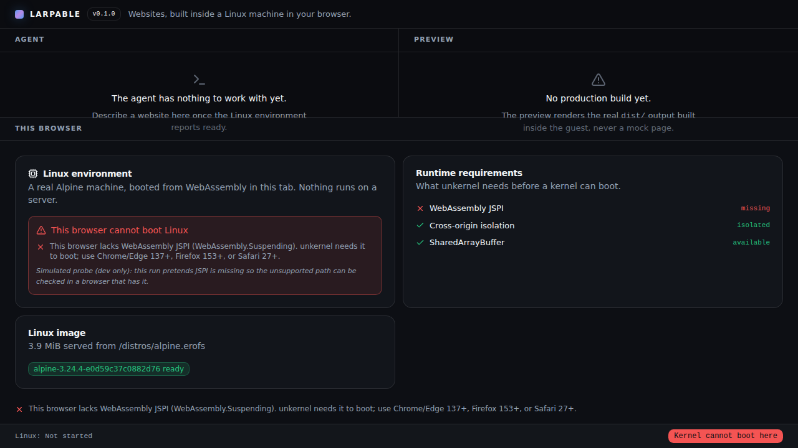

# Browser boot report

Evidence that the VM actually boots in a browser and that the workspace round-trips,
plus what a browser that cannot boot it is shown. Every value below was read off the
running app in a Playwright-driven Chromium session against `bun run dev`; nothing here
is estimated.

## Session

| Field | Value |
| --- | --- |
| Date | 2026-11-22 |
| Browser | Google Chrome for Testing 159.0.8154.6 (Playwright Chromium) |
| Page | `http://127.0.0.1:5173/` (`bun run dev`, Vite dev server) |
| Distro image | `alpine-3.24.4-e0d59c37c0882d76` from `/distros/alpine.erofs` (3.9 MiB) |
| Kernel | `Linux unkernel 7.3.4+ #909a1964cecb SMP Fri Nov 20 16:38:40 UTC 2026 aarch64 Linux` |
| Config | 1024 MiB, 2 CPUs, worker mode, persistent IndexedDB data disk, Wisp networking |

## Supported browser: boot to ready

Support probe before booting reported JSPI `available`, cross-origin isolation
`isolated` and `SharedArrayBuffer` `available`, so the boot button was offered.

Clicked **Boot Linux**; the panel reported:

- status **Ready**, distro badge `alpine`, `2 CPUs`, `1024 MiB`,
- **booted in 3.4 s** (measured by `useEnvironmentBoot`, wall clock from click to ready).

## Supported browser: self-test round-trip

Clicked **Run self-test**. The whole check took **250 ms** and all three steps passed:

| Step | Result |
| --- | --- |
| Run a command in the guest | `uname -a` → `Linux unkernel 7.3.4+ #909a1964cecb SMP Fri Nov 20 16:38:40 UTC 2026 aarch64 Linux` |
| Write from the host, read in Linux | `/workspace/.larpable/host-to-guest.txt` arrived intact |
| Write in Linux, read on the host | `/workspace/.larpable/guest-to-host.txt` arrived intact |

Summary line rendered by the panel: “The guest answered and the workspace round-trips.
250 ms”.

The status bar at the bottom simultaneously read:

```
Linux: Ready | Distro: alpine | Runtime: node (guest shim) | CPUs: 2 | Memory: 1024 MiB
```


## Unsupported browser path

Opened `http://127.0.0.1:5173/?simulateSupport=no-jspi`, the dev-only probe simulation
that pretends `WebAssembly.Suspending` is missing (the one failure a capable CI browser
cannot otherwise reach). The panel rendered:

- heading **“This browser cannot boot Linux”**,
- the explanation **“This browser lacks WebAssembly JSPI (WebAssembly.Suspending).
  unkernel needs it to boot; use Chrome/Edge 137+, Firefox 153+, or Safari 27+.”**,
- a note that the probe is simulated in this run,
- the Runtime requirements card showed `WebAssembly JSPI — missing (unsupported)`,
- **no controls at all** (snapshot `controls: []`): no Boot Linux button, so a user is
  never invited to start a kernel that cannot work, and the page does not spin forever.



## Why this is browser evidence and not a claim

The numbers come from the app's own state machine (`EnvironmentSnapshot`,
`bootDurationMs`) and from the self-test that runs real commands in the guest through
the 9p-mounted `/workspace` — the same code path a user exercises. The screenshots are
of the page as rendered. The same behaviour is covered headlessly by `bun run test`
(`tests/boot.test.ts`, `tests/self-test.test.ts`, `tests/app.test.tsx`) and by
`bun run test:guest`, which boots the real Alpine kernel under Node.

## Reproducing

```sh
bun run dev                      # Vite on :5173 with COOP/COEP headers
# open http://127.0.0.1:5173/ , click "Boot Linux", then "Run self-test"
# open http://127.0.0.1:5173/?simulateSupport=no-jspi for the unsupported path
```

The guest's own network access (needed by `npm install`) goes through a Wisp proxy.
Setting `VITE_LINUX_NETWORK=0` resolves the boot config to `network: "none"` for hosts
that do not run a proxy.
