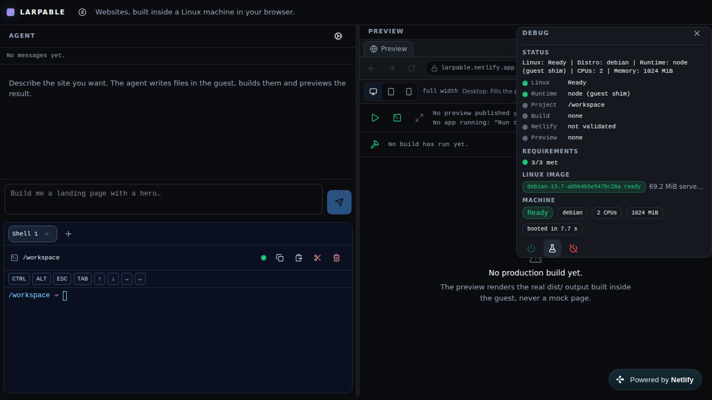
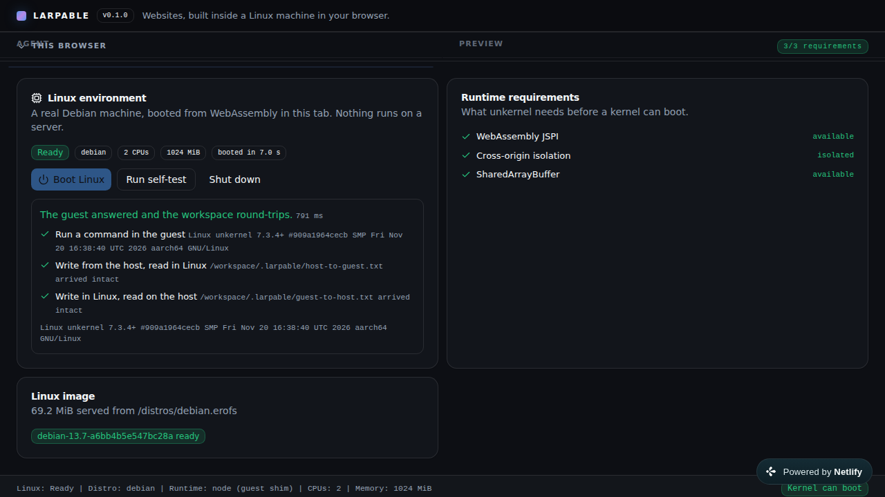

# Production deployment report

What https://larpable.netlify.app/ actually does, measured against the live site after the
deploy of commit `375934c` ("fix(deploy): ship the Linux image"). Nothing here is inferred
from configuration alone.

## What was broken

The site loaded and looked healthy — support probe green, boot button offered — but the
Linux image was missing:

| Request | Before | Cause |
| --- | --- | --- |
| `/distros/distros.json` | `200 text/html`, 1116 bytes | SPA fallback served `index.html` |
| `/distros/alpine.erofs` | `200 text/html`, 1116 bytes | same |
| Panel | "Image unavailable — Unexpected token '<' … is not valid JSON" | the app parsed HTML as JSON |

Root cause: `public/distros/` is git-ignored, so the Netlify build had no image, and
`[[redirects]] from "/*" to "/index.html"` answered the misses with a 200. Booting was
impossible even though every browser requirement was met.

## The fix

1. `prebuild` in `package.json` runs `bun run fetch:distros`; the image is downloaded from
   the release pinned to the installed unkernel version and verified by SHA-256. It is a
   no-op when the cached file is valid, so local builds stay fast and offline builds keep
   working.
2. `loadDistroManifest()` treats `text/html` as "this deployment is missing
   public/distros/" instead of surfacing a JSON parse error, and `probeDistroAsset()` no
   longer reports an SPA fallback page as a present image.

Verified from a clean checkout state before deploying:

```
$ rm -rf public/distros dist && bun run build
$ bun run fetch:distros
[fetch:distros] download …/alpine.erofs
[fetch:distros] saved    public/distros/alpine.erofs (4046848 bytes)
[fetch:distros] alpine  alpine-3.24.4-e0d59c37c0882d76 3.9 MiB sha256 verified
✓ built in 10.69s
$ ls -la dist/distros
alpine.erofs   4046848
distros.json       291
```

Deployed with `netlify deploy --dir=dist --prod` (site `larpable`, id
`a5203e52-f979-4761-8e2f-2d8453dda811`, deploy `6b02bd012fc3191d22bc495c`).

## Measured after the deploy

| Request | Result |
| --- | --- |
| `GET /distros/alpine.erofs` | `200`, **4 046 848 bytes**, `application/octet-stream` |
| `GET /distros/distros.json` | `200`, 291 bytes, `application/json` |
| `GET /` | `200`, `text/html`, `cross-origin-opening-policy: same-origin`, `cross-origin-embedder-policy: require-corp`, `x-content-type-options: nosniff` |

Cross-origin isolation survives the CDN, which is what `SharedArrayBuffer` and the
worker/SMP path need.

## Booting in production (Playwright Chromium, https://larpable.netlify.app/)

- Panel: support probe green (JSPI available, isolated, SharedArrayBuffer available),
  Linux image `alpine-3.24.4-e0d59c37c0882d76 ready — 3.9 MiB served from /distros/alpine.erofs`.
- Clicked **Boot Linux** → **Ready**, `alpine`, `2 CPUs`, `1024 MiB`, **booted in 4.2 s**.
- Status bar: `Linux: Ready | Distro: alpine | Runtime: node (guest shim) | CPUs: 2 | Memory: 1024 MiB`.
- Clicked **Run self-test** → *"The guest answered and the workspace round-trips. 218 ms"*:
  - `uname -a` → `Linux unkernel 7.3.4+ #909a1964cecb SMP Fri Nov 20 16:38:40 UTC 2026 aarch64 Linux`
  - `/workspace/.larpable/host-to-guest.txt arrived intact`
  - `/workspace/.larpable/guest-to-host.txt arrived intact`



## Known gaps in this deployment

- Guest network access (needed by `npm install`) goes through unkernel's default Wisp
  proxy; the self-test proves the shell and the mount, not that the proxy allows a
  registry. A self-hosted proxy is configured with `VITE_WISP_SERVER`.
- Deployment is not yet automated from Git in this repository's CI. The CLI deploy above
  used the same `bun run build` Netlify would run, and `prebuild` makes a Git build
  equivalent.
- Reproducing: `netlify link --id a5203e52-f979-4761-8e2f-2d8453dda811`, then
  `bun run build && netlify deploy --dir=dist --prod`.

## Deploy after the Netlify configuration module (commit `395e6e3`)

Deployed with `netlify deploy --dir=dist --prod` (site `larpable`, deploy
`6b039de7ae30801562143f88`). The build ran `prebuild` → `fetch:distros`, so the image
shipped in this deployment is the **Debian** one, not the Alpine image the earlier section
of this report measured.

Measured against https://larpable.netlify.app/ after the deploy:

| Request | Result |
| --- | --- |
| `GET /` | `200`, `text/html`, `cross-origin-opener-policy: same-origin`, `cross-origin-embedder-policy: require-corp`, `x-content-type-options: nosniff` |
| `GET /distros/distros.json` | `200`, 290 bytes, `application/json`, one entry: `debian` |
| `GET /distros/debian.erofs` | `200`, **72 593 408 bytes**, `application/octet-stream` |
| `GET /distros/nope.erofs` | `404`, 1116 bytes (a real 404, not the SPA entry point) |

Booted in production with Playwright Chromium against the live URL:

- Panel: **3/3** requirements, Linux image `debian-13.7-a6bb4b5e547bc28a ready — 69.2 MiB
  served from /distros/debian.erofs`.
- **Boot Linux** → **Ready**, `debian`, 2 CPUs, 1024 MiB, **booted in 7.0 s**.
- **Run self-test** → *"The guest answered and the workspace round-trips. 791 ms"*:
  - `uname -a` → `Linux unkernel 7.3.4+ #909a1964cecb SMP Fri Nov 20 16:38:40 UTC 2026 aarch64 GNU/Linux`
  - `/workspace/.larpable/host-to-guest.txt arrived intact`
  - `/workspace/.larpable/guest-to-host.txt arrived intact`
- Status bar: `Linux: Ready | Distro: debian | Runtime: node (guest shim) | CPUs: 2 | Memory: 1024 MiB`



This deploy also settles the image-name half of goal #17: the production asset is now
`debian.erofs` at its measured 72 593 408 bytes, so the older `alpine.erofs`
(4 046 848 bytes) acceptance figure is history, not a current expectation.
