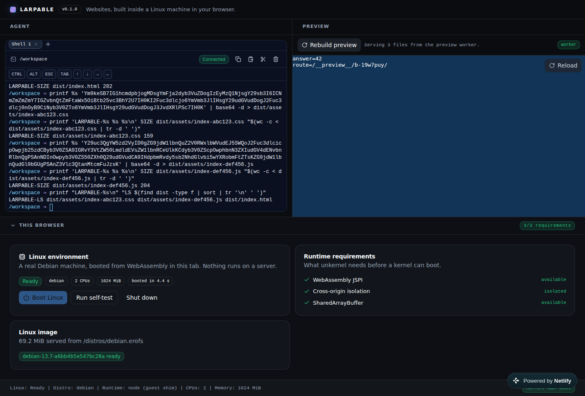
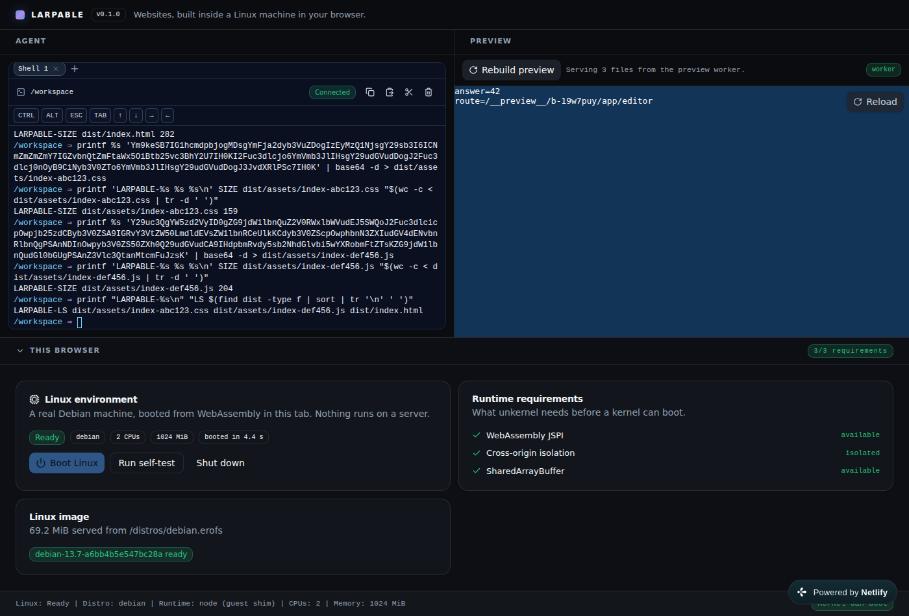

# Preview browser report

Generated by `bun run acceptance:preview`. Every value below was read out of the page —
or out of the iframe's own document — during a real browser session against a real
guest. Re-run the command to replace this file with fresh measurements.

**Verdict: PASS** — 17/17 checks passed.

## Session

| Field | Value |
| --- | --- |
| Started at | 2026-11-23T05:12:02.638Z |
| Browser | Chromium 159.0.8154.6 |
| Chromium binary | `/root/.cache/ms-playwright/chromium-1255/chrome-linux64/chrome` |
| Page | https://larpable.netlify.app |
| Dev server | already running at https://larpable.netlify.app |

## Checks

| Check | Result | Detail |
| --- | --- | --- |
| the guest booted to Ready | PASS | Ready |
| a shell is attached to the guest | PASS | terminal panel reports connected |
| the guest's node answered | PASS | [?2004l
LARPABLE-RUNTIME node=v26.13.1 |
| node reports a version | PASS | [?2004l
LARPABLE-RUNTIME node=v26.13.1 |
| the guest took dist/index.html whole (282 bytes) | PASS | [?2004l
LARPABLE-SIZE dist/index.html 282 |
| the guest took dist/assets/index-abc123.css whole (159 bytes) | PASS | [?2004l
LARPABLE-SIZE dist/assets/index-abc123.css 159 |
| the guest took dist/assets/index-def456.js whole (204 bytes) | PASS | [?2004l
LARPABLE-SIZE dist/assets/index-def456.js 204 |
| the build is in the guest's dist/ | PASS | [?2004l
LARPABLE-LS dist/assets/index-abc123.css dist/assets/index-def456.js dist/index.html  |
| dist/ holds the three build files | PASS | [?2004l
LARPABLE-LS dist/assets/index-abc123.css dist/assets/index-def456.js dist/index.html  |
| the pane published a build | PASS | build id b-19w7puy |
| the preview worker holds the build | PASS | served by worker, and the controller gave no reason |
| the preview URL names the build | PASS | /__preview__/b-19w7puy/ |
| the iframe has a document | PASS | contentFrame() resolved |
| the build's stylesheet applied inside the iframe | PASS | computed body background is rgb(18, 52, 86), expected rgb(18, 52, 86) |
| the build's module executed inside the iframe | PASS | #answer reads "42" |
| an SPA deep link resolves to the entry document | PASS | #answer reads "42" — the fallback did not serve index.html |
| the deep link keeps its own path | PASS | #route reads "/__preview__/b-19w7puy/app/editor" |

## The guest

| Field | Value |
| --- | --- |
| Status badge | Ready |
| Runtime detected at boot | Linux: Ready | Distro: debian | Runtime: node (guest shim) | CPUs: 2 | Memory: 1024 MiB |
| Click to Ready | 5126 ms |

## Warming the runtime the preview server needs

The guest's `node` is a first-use shim: in a fresh profile the first call downloads the
runtime. The run pays that once, in the terminal, and measures it:

```
[?2004l
LARPABLE-RUNTIME node=v26.13.1
```

Answered: **true**, wall clock: **132080 ms**.

## The build, as written into the guest

```
[?2004l
LARPABLE-LS dist/assets/index-abc123.css dist/assets/index-def456.js dist/index.html 
```

Written one file per command: the bytes travel as base64 (`printf %s … | base64 -d`,
which no quote or `$` can break) and the guest prints the byte count `wc -c` measured
for itself, so a truncated write fails the run instead of passing it.

Three files: an SPA entry with root-absolute `/assets/…` URLs, a stylesheet that paints
the body `#123456`, and a module that writes `42` into `#answer` and `location.pathname`
into `#route`. Root-absolute URLs are what a real build emits, and what `routing.ts` has
to rebase for the preview's subpath.

## Publishing to the service worker

| Field | Value |
| --- | --- |
| Build id in the iframe's URL | `b-19w7puy` |
| iframe `src` | `/__preview__/b-19w7puy/` |
| Pane status | Serving 3 files from the preview worker. |
| Served by | worker |
| Why the guest answered, if it did | (not applicable) |
| Click to published iframe | 8220 ms |

**Served by the worker**: the service worker answered from the published snapshot, so the
iframe's own module and stylesheet requests never made a round trip into the guest.

## What the iframe rendered

| Measurement | Value | Meaning |
| --- | --- | --- |
| `getComputedStyle(body).backgroundColor` | `rgb(18, 52, 86)` | the stylesheet the build emitted applied |
| `#answer` text | `42` | the build's module executed |

Body text as the frame sees it:

```

42
/__preview__/b-19w7puy/


```

stylesheet applied: **true**, module executed: **true**



## An SPA deep link

Navigated the iframe to `https://larpable.netlify.app/__preview__/b-19w7puy/app/editor` — a path that exists in no file, exactly what a
router-based site needs at runtime.

| Field | Value |
| --- | --- |
| `#route` (written from `location.pathname`) | `/__preview__/b-19w7puy/app/editor` |
| `#answer` (the module ran again) | `42` |
| `document.title` | guest-js-ran |



## Why this is evidence and not a claim

The build is written into `/workspace/dist` through the guest's own terminal, so the bytes
come from inside the VM. The pane is then published by the app's real code path —
`startPreviewServer` → `collectPreviewSnapshot` → the worker's publish protocol →
`PreviewFrame` — with no test-only shortcut. The assertions are read out of the rendered
document: a computed background colour the build's CSS chose, a value the build's module
wrote, and the pathname of a deep link.

## Reproducing

```sh
bun run dev            # or let the script start one
bun run acceptance:preview
```
