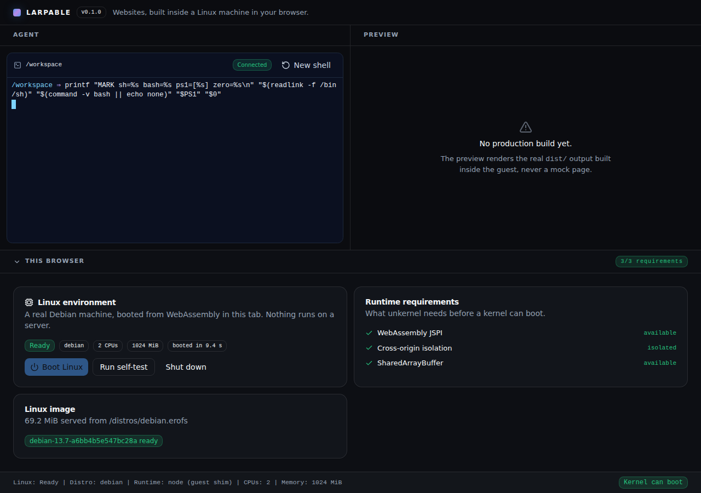

# The guest terminal prompt: what was wrong, and what fixed it

Two user reports arrived together:

> "i cannot highlight and select text on the terminal"
> "the terminal /workspace > is not showing"

Both had one cause. This report records the measurement, the fix, and the evidence — the
numbers below came out of a real browser session (`scripts/probe-terminal.ts`), not from
reading the code and assuming.

## Reproducing

```sh
bun run dev                                             # in another terminal
LARPABLE_ACCEPTANCE_URL=http://127.0.0.1:5173 bun scripts/probe-terminal.ts
```

The probe boots the real Debian guest in Chromium, waits for the shell to attach, reads
xterm's own buffer (`.xterm-rows`), drags the mouse across the first rendered line, then
types a command into the pty and reads the reply.

## What the terminal actually showed

Before the fix, the buffer contained:

```
\[\033[36m\]\w \[\033[35m\]⇒\[\033[0m\]
```

That is the image's `PS1` printed **verbatim**. `UnkernelEnvironment.openShell` spawned
`/bin/sh -l`, and on Debian `/bin/sh` is `dash`, which expands none of `\[`, `\]`,
`\033` or `\w`. So:

- there was no visible `/workspace ⇒` prompt — the second report, exactly;
- the only "text" on screen was escape litter, so a drag selected escape litter — the
  first report. Selection itself was never broken: the drag produced
  `window.getSelection() === "\\[\\033[36m\\]\\w …"` and two visible `.xterm-selection`
  divs, and `document.elementFromPoint()` in the middle of the pane returned
  `div.xterm-screen`, so no overlay was eating the mouse.

The shell was wrong, not the terminal.

## The fix

`src/env/shell.ts` decides which program a terminal runs, from a measurement rather than a
constant:

| Guest has bash | What opens | Prompt |
| --- | --- | --- |
| yes (Debian) | `/bin/bash -li` | the image's own prompt, which bash renders |
| no | `/bin/sh -i` | `PS1=larpable$ ` — no escapes for anything to not expand |

Three details are deliberate:

- **`-l` for bash**: `/etc/profile` is where the image defines its prompt, so a login
  shell is required to see it.
- **`-i` for both**: a terminal should be interactive because it asked to be, not because
  pty detection happened to agree.
- **no `-l` for the dash fallback**: a login `dash` re-reads `/etc/profile` and puts the
  bash-only `PS1` straight back on screen — the original bug. Interactive but not login,
  plus an expansion-free `PS1` in the environment, is the only combination that is
  readable in a POSIX shell with no prompt escapes.

Detection costs nothing: the boot probe that already had to run (`#verifyShell`) now also
answers `command -v bash`, one line, one process:

```sh
printf 'larpable-ok %s' "$(command -v bash 2>/dev/null || echo none)"
```

A bash that exists but cannot be spawned is handled too: `openShell` walks the attempt
list and, if every shell fails, reports each command it tried (`/bin/bash -li, /bin/sh -i`)
with the underlying error, instead of failing anonymously.

## After the fix (measured)

```
state.bufferText : "/workspace ⇒  "
drag             : { windowSelection: "/workspace ⇒ ",
                     selectionDivs: 2, selectionVisible: true }
typed            : zero=/bin/bash   ps1=[\[\e]0;\u@\h: \w\a\]\[\033[36m\]\w …⇒… ]
verdict          : PASS
```

The transcript shows real control sequences now (`\u001b[36m/workspace \u001b[35m⇒`), the
shell reports itself as `/bin/bash`, and the drag selects `/workspace ⇒` — readable text.



## Regression cover

- `tests/terminal-shell-plan.test.ts` (14) — bash first, dash fallback behind it, the
  fallback never uses `-l`, the fallback prompt contains no bash-only escapes, an explicit
  `PS1`/`file`/`args` wins, and `parseBashProbe` refuses to guess from a non-path.
- `tests/unkernel-environment.test.ts` — the adapter asks the kernel for a pty with
  `/bin/bash -li`, falls back to `/bin/sh -i` when bash cannot spawn, opens the safe-prompt
  dash when the guest has no bash, and names every attempt when none works.
- `bunx vitest run`: **304 passed, 4 skipped**. `bun run typecheck`: clean.

## Limits worth stating

- The prompt is now the image's, so it changes when the image changes. That is the point:
  Larpable no longer substitutes its own idea of a prompt for the one the guest ships.
- The dash fallback prompt does not show the current directory. `dash` has no
  `PROMPT_COMMAND` and no `\w`, so a path-aware prompt would be a lie there. It is
  reachable only on an image without bash.
- `bash -li` reads `/etc/profile`, which on a modified image could print a banner. That
  is the image's decision, not something the terminal should suppress.
